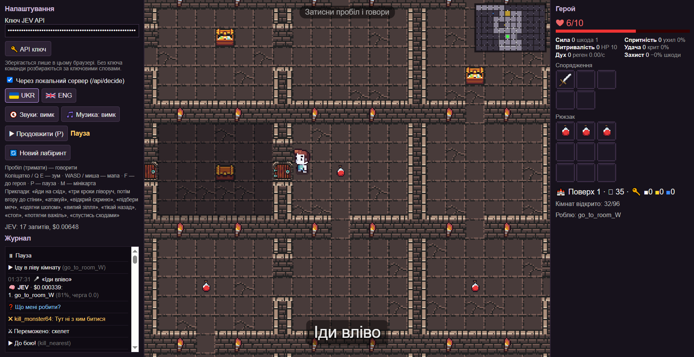

# Tell Me What To Do — «Скажи, що робити»

**[English version → README.md](README.md)**

Невелика браузерна гра-підземелля, де **ти не керуєш героєм, а говориш із ним.**
Затисни Пробіл, скажи, що робити («йди на схід, потім атакуй скелета»), і допитливий, трохи наївний
герой спробує виконати. Він не знає, де пастки й лава, який ключ до яких дверей підходить і що скриня в кутку дихає.
Ти бачиш мапу, він ні.

Голосові команди перетворює на план **JEV** ([TypeSafe](https://typesafe.ai) System One, модель `jev-latest`).
Без API-ключа гра розбирає команди за ключовими словами (українська + англійська), тож грати можна безкоштовно.

 

## Можливості (Спойлери)

- **3 поверхи** (1 → −1 → −2), на кожному новий лабіринт 12×8 кімнат (96 кімнат), є мінікарта.
- **Кольорові ключі** й відповідні двері: білі ведуть до сходів униз (поверхи 1 і −1), жовті до схованки з кращим мечем (кожен поверх), сині до кімнати з важелем (лише поверх −2).
- **Важіль** на останньому поверсі відчиняє ґрати до демона. Їх охороняють 3 скелети, маг і кусака.
- **Компас** (завжди на 1-му поверсі): жовта стрілка біля героя вказує на найближчий ключ, який ти ще не підібрав.
- Вороги: скелети з мечами, **вампіри-чаклуни** з магічними снарядами (від них можна ухилитися рухом), **кусаки**, що женуться крізь двері, **міміки** (придивись до короткої «зубастої» підказки, герой її не помічає), і демон-бос.
- Приховані шипи, кімнати суцільної лави (герой зайде туди, якщо накажеш).
- **Самостійність героя:** якщо мовчиш, він діє сам. Тікає назад після влучання магії або коли сильно поранений, сам б'ється з одним слабким ворогом, відкриває скрині, а після 12–20 с тиші йде подивитися в сусідню кімнату («А що там?»). Будь-яка голосова команда його перериває.
- **Відповіді «Га?»:** коли герой не розуміє команду, він відповідає смішною дитячою фразою. З API-ключем той самий запит до JEV ще й визначає, що саме ти сказав (привітання, образа, їжа, «полети!», нісенітниця…), тож жарт пасує.
- Інтерфейс і голос **українською та англійською** (кнопки UKR / ENG).

## Вимоги

- **Node.js** 18+ (перевірено на Node 24). `npm install` не потрібен, залежностей немає.
- **Chrome або Edge** (десктоп) для розпізнавання мови (Web Speech API). В інших браузерах гра відкриється, але не слухатиме.
- Мікрофон.
- Необов'язково: API-ключ TypeSafe для JEV.

## Запуск

```bash
node server.js            # http://localhost:9123
PORT=8080 node server.js  # інший порт (Windows: set PORT=8080 && node server.js)
```

На Windows можна просто двічі клацнути `start.bat`: він запустить сервер на порту 9123 і відкриє браузер.

Сервер віддає статичні файли й проксує `POST /api/decide` → `https://api.typesafe.ai/v1/systemone`.
Проксі обходить CORS і пише останній запит і відповідь у `tools/last-jev.json` для налагодження.

## Ключ TypeSafe (необов'язково)

1. Отримай ключ на **https://console.typesafe.ai/keys** (туди веде кнопка 🔑 у налаштуваннях).
2. Встав його в налаштуваннях. Ключ зберігається **лише в** `localStorage` **твого браузера** (`jev_key`). Він іде тільки на локальний проксі, а той пересилає його в TypeSafe.
3. Вартість рахується за вхідні токени (гра оцінює `input_tokens × $0.000000042`). Типова команда займає близько 6–8 тис. вхідних токенів, тобто **приблизно $0.0003 за команду** (≈3000 команд на долар). Сума показується в HUD.

Без ключа команди розбираються за ключовими словами. Для простих наказів цього досить; JEV розуміє вільну мову й багатокрокові плани.

## Як грати

- Натисни **Старт** (або P), потім **затисни Пробіл і говори**. Відпусти, щоб надіслати.
- Камера: коліщатко або Q/E для зуму, WASD або перетягування для руху мапи, F повертає до героя, M вмикає мінікарту (клік по ній переносить туди камеру), P ставить паузу.
- Мета: знайти ключі, двічі спуститися сходами, на поверсі −2 потягнути важіль, перемогти демона й дійти до виходу.

Приклади команд: «йди на схід», «йди в нижню кімнату», «три кроки ліворуч, потім вгору до стіни», «атакуй скелета»,
«відкрий скриню, потім підбери меч», «одягни шолом», «випий зілля», «тікай назад», «стоп», «потягни важіль», «спустись сходами».
Англійською: "go east", "attack the skeleton", "pull the lever", "go downstairs"…

Поради: кольорові двері герой відчиняє сам, коли ти посилаєш його крізь них і в нього є ключ того ж кольору (ключ витрачається). Сам по собі ключів він не використовує. Пастки й лаву бачиш ти, а не він: проводь його повз них крок за кроком.

## Структура проєкту

```
index.html        розмітка, стилі, атрибути data-i18n
server.js         статичний сервер + проксі /api/decide до TypeSafe (змінна PORT, типово 9123)
start.bat         запуск під Windows
src/
  main.js         зв'язка: UI, HUD, журнал, голос → JEV/ключові слова → план, події → бульбашка/звук
  game.js         стан і правила: герой, цілі/макроси, бій, двері/ключі/важіль, поверхи, самостійність, ШІ ворогів
  maze.js         генератор лабіринту для кожного поверху (кімнати, двері, спецкімнати, ключі, пастки, лава), FLOORS, баланс BAL
  path.js         A* по сітці (з діагоналями)
  items.js        предмети, формули характеристик, таблиці луту
  agent.js        дії, які бачить JEV у поточній кімнаті, опис стану, розбір за ключовими словами
  plan.js         запитання до JEV (noul + score), вибір плану, поділ команди на частини
  jev.js          запит до TypeSafe System One
  huh.js         смішні відповіді «не зрозумів» (категорії й вибір; фрази в i18n)
  render.js       рендер на canvas (тайли, сутності, згладжування, снаряди, компас, мінікарта, бульбашки)
  assets.js       шляхи до спрайтів і звуків
  audio.js, speech.js   звуки/музика, обгортка Web Speech
  i18n.js         рядки українською та англійською
tools/
  test-logic.mjs  тести без браузера (node tools/test-logic.mjs)
  oracle.mjs      бот-«добрий підказувач» для симуляцій балансу
  sim.mjs         спільний цикл симуляції (підказувач відповідає ~за 3 с після того, як у героя закінчились накази)
  tune-enemies.mjs  перевірка налаштувань балансу: node tools/tune-enemies.mjs '[{"boltCd":6}]' 80
  make-items.mjs, make-tiles.mjs   генерація піксельних іконок предметів / тайлів лави
  check-walls.mjs, preview-rooms.mjs, check-assets.mjs   прев'ю та перевірки для налагодження
```

## Як JEV будує план

1. Сказана команда ділиться на **частини** («йди на схід, потім атакуй» → 2 частини) за сполучниками мови (`потім`, `і`, `then`, `and`, …).
2. Гра складає список усіх доречних зараз дій: макроси поточної кімнати (`go_to_room_E`, `kill_monster12`, `open_chest_chest7`, `pull_lever`, …) і загальні (`move_west_3`, `drink_potion`, `wait`, …).
3. **Один запит** ставить по два запитання на кожну дію:
   - `noul` (ймовірність 0..1): «чи просить команда цю дію?»
   - `score` (рівні = частини команди): «до якої частини команди належить ця дія?»
4. Лишаються дії з noul > 0.5 (максимум 5), упорядковані за score. Цей список і є план. Він видно в журналі (🧠) і в бульбашці героя.
5. Нова команда перериває поточний план, а відповіді на старі команди відкидаються.

## Як додати вміст

- **Новий ворог:** базові характеристики в `monsterStats` (`maze.js`), спрайти в `ENEMY`/`IMAGES` (`assets.js`), малювання в `drawMonster` (`render.js`), поведінка в циклі ворогів у `Game.update` (`game.js`, приклади `mageAct`/`chompFollow`), назви `mon.`*/`monAcc.`* в `i18n.js`, англійський опис у `MON_EN` (`agent.js`), і додати його в `mix` потрібного поверху у `FLOORS`.
- **Новий предмет:** `ITEMS` в `items.js` (і таблиця луту `FLOORS[].loot` у `maze.js`), іконка в `tools/make-items.mjs` (і запустити його), `ITEM_ICONS` в `assets.js`, назви `item.<id>` в `i18n.js`, за бажанням шаблони в `ITEM_RX` (`agent.js`).
- **Новий тип кімнати:** задати `r.type` у `genOnce` (`maze.js`), щоб `solvable()` лишався істинним, і намалювати в `render.js` (також кольори мінікарти).
- **Нова дія/макрос:** розібрати мітку в `Game.resolve`, виконати в `Game.runGoal`, запропонувати в `roomActions`/`genericActions` (`agent.js`) з чітким англійським описом, додати короткий опис у `DESC` (`plan.js`), репліку в `sayFor` і ключові слова в `RX`.
- **Рядки:** усі тексти інтерфейсу, журналу й реплік лежать в `i18n.js` у `uk` і `en`. Тести падають, якщо ключ є лише в одній мові.

## Тести й баланс

```bash
node tools/test-logic.mjs
```

Тести покривають:

- генерацію всіх поверхів (по 200 сідів: зв'язність, тупикові спецкімнати, ключ ніколи не за власними дверима, компас на 1-му поверсі);
- логіку ключів, дверей, важеля, сходів, компаса й міміків;
- правила самостійності героя та поведінку ворогів;
- ключові слова обома мовами;
- вибір плану JEV на змодельованих відповідях;
- повноту i18n;
- повні проходи трьох поверхів із ботом-підказувачем.

Перемоги підказувача тримаються на рівні ~35–50%. Без жодних команд герой практично не виграє.

## Автори й ліцензії ассетів

Ліцензії ассетів належать їхнім авторам.

| Ассет | Автор | Ліцензія (як вказує автор) | Де |
|---|---|---|---|
| 16x16 DungeonTileset II v1.7 | 0x72 (Robert Norenberg) | CC0 1.0 (згадка необов'язкова), https://0x72.itch.io/dungeontileset-ii | `assets/environment/0x72_DungeonTilesetII_v1.7` (файлу ліцензії всередині немає; вказано на сторінці itch) |
| 2D Pixel Dungeon Asset Pack v2.0 + Enemy_Animations_Set | Pixel_Poem | Можна у безкоштовних і комерційних проєктах, можна змінювати, згадка бажана; **«You may not redistribute it or resell it»**, https://pixel-poem.itch.io/dungeon-assetpuck | `assets/environment/2D Pixel Dungeon Asset Pack v2.0`, `assets/environment/Enemy_Animations_Set` |
| Top-Down Character Animations (герой) | Eduardo Scarpato / Dagon Dev | CC0 (за `assets/LICENSE.txt`), https://eduardscarpato.itch.io/top-down-character | `assets/characters` |
| Survival Kit [Pixel Art 16x16] (безкоштовна версія) | Eduardo Scarpato / Dagon Dev | див. сторінку itch (`assets/LICENSE.txt` радить перевірити); поточний код його не використовує | `assets/environment/Sprites` |
| Emotes pack | Kenney (kenney.nl) | CC0 (`assets/emotes/kenney_emotes-pack/License.txt`) | `assets/emotes` |
| The Essential Retro Video Game Sound Effects Collection [512 sounds] | Juhani Junkala | CC0 (`INFO.txt`) | `assets/sound/...` |
| 5 Action Chiptunes | Juhani Junkala | CC0 (`INFO.txt`) | `assets/sound/...` |
| RPG Sound Pack | artisticdude (OpenGameArt) | CC0, https://opengameart.org/content/rpg-sound-pack (файлу ліцензії всередині немає) | `assets/sound/RPG Sound Pack` |
| Іконки предметів, тайли лави | згенеровано `tools/make-items.mjs`, `tools/make-tiles.mjs` | як код проєкту | `assets/items`, `assets/tiles` |


Налагодження: URL-параметри `?near` `?god` `?compass` `?test` (усі), поєднуються через `&`.